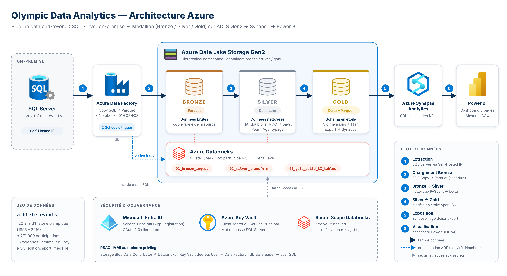
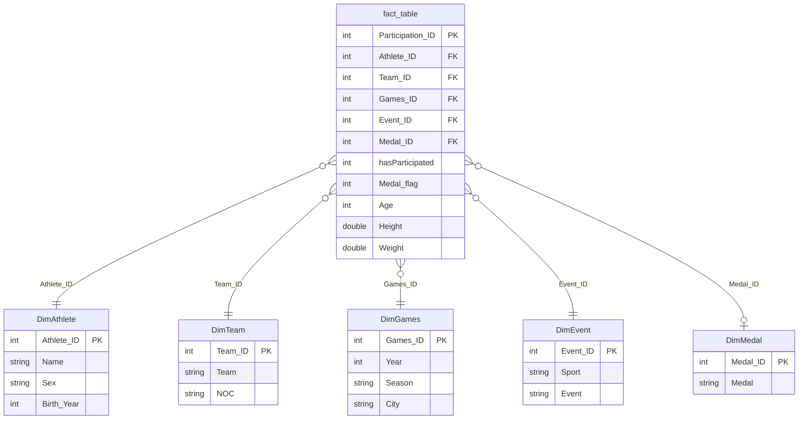

# 🏅 Olympic Data Analytics sur Azure

Pipeline data **end-to-end sur Microsoft Azure** : ingestion des données historiques des Jeux Olympiques depuis une base **SQL Server on-premise**, traitement selon une architecture **Medallion (Bronze / Silver / Gold)** dans **Azure Databricks**, exposition via **Azure Synapse Analytics** et restitution dans un **dashboard Power BI** interactif.


---

## 📑 Sommaire

- [Objectif](#-objectif)
- [Architecture](#-architecture)
- [Stack technique](#-stack-technique)
- [Structure du dépôt](#-structure-du-dépôt)
- [Étapes du projet](#-étapes-du-projet)
- [Détail du pipeline](#-détail-du-pipeline)
- [Modèle de données (Gold)](#-modèle-de-données-gold)
- [Dashboard Power BI](#-dashboard-power-bi)
- [Sécurité & gouvernance](#-sécurité--gouvernance)
- [Reproduire le projet](#-reproduire-le-projet)
- [Pistes d'amélioration](#-pistes-damélioration)
- [Auteur](#-auteur)

---

## 🎯 Objectif

Construire une plateforme analytique cloud capable de :

1. **Ingérer** des données depuis une source on-premise de façon sécurisée ;
2. **Nettoyer et standardiser** des données historiques hétérogènes (valeurs `NA`, années invalides, noms d'équipes non harmonisés…) ;
3. **Modéliser** les données en **schéma en étoile** prêt pour la BI ;
4. **Analyser** plus d'un siècle de participations olympiques : athlètes, pays, sports, médailles et tendances temporelles.

**Jeu de données :** `athlete_events` – *120 years of Olympic history: athletes and results* (Kaggle), ~270 000 lignes (une ligne = un athlète × une épreuve × une édition).

---

## 🏗 Architecture



```
On-Prem SQL Server ──(ADF + Self-Hosted IR)──▶ ADLS Gen2 [bronze]  (Parquet)
                                                   │
                                     Azure Databricks (PySpark)
                                                   ▼
                                           ADLS Gen2 [silver]  (Delta)
                                                   │
                                     Azure Databricks (Spark SQL)
                                                   ▼
                                           ADLS Gen2 [gold]    (Delta + export Parquet)
                                                   │
                                        Azure Synapse Analytics (SQL)
                                                   ▼
                                               Power BI
        Sécurité transverse : Microsoft Entra ID (Service Principal, RBAC) + Azure Key Vault
```

---

## 🧰 Stack technique

| Couche | Service | Rôle |
|---|---|---|
| Source | SQL Server (on-premise) | Table `dbo.athlete_events` |
| Ingestion | Azure Data Factory + Self-Hosted Integration Runtime | Copie SQL Server → ADLS Gen2 (Parquet) |
| Stockage | ADLS Gen2 (namespace hiérarchique) | Containers `bronze`, `silver`, `gold` |
| Traitement | Azure Databricks (PySpark, Spark SQL, Delta Lake) | Nettoyage, transformation, modélisation |
| Serving | Azure Synapse Analytics | Requêtes SQL / KPIs sur la couche Gold |
| Visualisation | Power BI (DAX) | Dashboard 5 pages |
| Sécurité | Microsoft Entra ID, Azure Key Vault, RBAC (IAM) | Identités, secrets, droits d'accès |

---

## 📂 Structure du dépôt

```
olympic-data-analytics-azure/
├── README.md
├── databricks/
│   ├── 00_auth.ipynb                     # Connexion OAuth Databricks → ADLS Gen2 (Service Principal + Key Vault)
│   ├── 01_bronze_ingest_athletes.ipynb   # Lecture des données brutes (Parquet) déposées par ADF
│   ├── 02_silver_transform_athletes.ipynb# Nettoyage & transformations PySpark → Delta
│   └── 03_gold_build_BI_tables.ipynb     # Schéma en étoile (dimensions + fait) + export pour Synapse
├── sql/
│   └── onprem_sqlserver_setup.sql        # Login / user / droits pour la lecture par ADF
├── powerbi/
│   └── Olympic_Dashboard.pbix            # Dashboard Power BI
└── docs/
    ├── images/architecture.png
    ├── setup_guide.md                    # Mise en place pas à pas des ressources Azure
    ├── data_model.md                     # Modèle en étoile de la couche Gold
    └── dashboard.md                      # Pages, visuels et KPIs du dashboard
```

---

## ✅ Étapes du projet

| # | Étape | Livrable |
|---|---|---|
| 1 | **Provisionnement Azure** : Resource Group, Storage Account (ADLS Gen2), Data Factory, Databricks, Synapse, Key Vault ; containers `bronze` / `silver` / `gold` | [Guide de mise en place](docs/setup_guide.md#1-provisionnement-des-ressources) |
| 2 | **Préparation de la source** : login/user SQL Server, rôle `db_datareader`, mot de passe stocké dans Key Vault | [`sql/onprem_sqlserver_setup.sql`](sql/onprem_sqlserver_setup.sql) |
| 3 | **Ingestion ADF** : Self-Hosted IR, Linked Services (SQL Server + Key Vault, ADLS Gen2), pipeline *Copy* → Parquet en Bronze | [Guide §3](docs/setup_guide.md#3-ingestion-avec-azure-data-factory) |
| 4 | **Connexion sécurisée Databricks ↔ ADLS** : App Registration, rôle *Storage Blob Data Contributor*, secret scope Key Vault, OAuth ABFS | [`00_auth`](databricks/00_auth.ipynb) |
| 5 | **Bronze** : lecture des données brutes | [`01_bronze_ingest_athletes`](databricks/01_bronze_ingest_athletes.ipynb) |
| 6 | **Silver** : nettoyage, normalisation, enrichissement → Delta | [`02_silver_transform_athletes`](databricks/02_silver_transform_athletes.ipynb) |
| 7 | **Gold** : modélisation en étoile + export Parquet pour Synapse | [`03_gold_build_BI_tables`](databricks/03_gold_build_BI_tables.ipynb) |
| 8 | **Serving** : exposition de la couche Gold dans Synapse Analytics, calcul de KPIs SQL | [Guide §6](docs/setup_guide.md#6-azure-synapse-analytics) |
| 9 | **Visualisation** : dashboard Power BI (5 pages, mesures DAX) | [`powerbi/`](powerbi/) · [docs](docs/dashboard.md) |

---

## 🔄 Détail du pipeline

### 1. Ingestion — Azure Data Factory
- Pipeline avec une activité **Copy** : source **SQL Server on-premise** → sink **ADLS Gen2** au format **Parquet** (`bronze/dbo.athlete_events.parquet`).
- La base étant on-premise, un **Self-Hosted Integration Runtime (SHIR)** est installé sur la machine hôte (l'`AutoResolveIntegrationRuntime` ne sert qu'aux services Azure).
- Le mot de passe SQL est lu dans **Key Vault** par ADF (rôle *Key Vault Secrets User* attribué à l'identité managée d'ADF).

### 2. Bronze — données brutes
Lecture du Parquet brut, sans transformation, pour garder une copie fidèle de la source.

### 3. Silver — nettoyage & transformation (PySpark)
| Problème | Traitement |
|---|---|
| Valeurs manquantes codées `"NA"` | `replace("NA", None)` |
| Lignes dupliquées | `dropDuplicates()` |
| Pas d'identifiant de ligne | `Participation_ID` via `row_number()` |
| Noms d'équipes non harmonisés (`Team`) | Mapping **NOC → pays** (≈ 230 codes) |
| `Year` / `Season` nuls ou invalides | Reconstruits depuis la colonne `Games` (ex. `"1992 Summer"`) |
| `Age` non numérique | Regex + cast `int`, sinon `null` |
| Pas d'année de naissance | `Birth_Year = Year - Age` (sert à identifier un athlète unique) |
| Types texte | `Height`, `Weight` castés en `double` |
| Indicateurs BI | `hasParticipated = 1`, `Medal_flag = 1` si médaille |

Résultat écrit en **Delta Lake** : `silver/athletes_transformed_data/`.

### 4. Gold — modélisation en étoile (Spark SQL)
- 5 dimensions dédoublonnées avec `ROW_NUMBER() OVER (PARTITION BY …)` et une **clé substitut** générée.
- 1 table de faits construite par **jointures null-safe (`<=>`)** pour ne pas perdre les lignes avec attributs nuls.
- Tables **Delta** dans `gold/dimensions/` et `gold/fact_table/`, plus des **snapshots Parquet** dans `gold/asa_export/` lus par Synapse.

### 5. Serving & BI
Synapse Analytics expose les tables Gold (Parquet) en SQL ; Power BI s'y connecte pour le dashboard.

---

## ⭐ Modèle de données (Gold)



Détails : [docs/data_model.md](docs/data_model.md)

---

## 📊 Dashboard Power BI

Fichier : [`powerbi/Olympic_Dashboard.pbix`](powerbi/Olympic_Dashboard.pbix) — 5 pages avec navigation et filtres (Sport, Année, Équipe, Médaille, Saison) :

| Page | Contenu principal |
|---|---|
| 🏠 **Home** | KPIs (participations, athlètes, médailles, pays, taux de médaille), évolution annuelle des participations, top équipes par médailles, participations par sport |
| 🏃 **Athletes** | Répartition par sexe, top 5 équipes par nombre d'athlètes, corrélation taille–poids, tableau de performance des athlètes |
| 🏅 **Medals & Podiums** | Athlètes par niveau de médaille, top 5 équipes par médaille, performance équipe × sport (Or/Argent/Bronze), médaillés par sexe |
| ⚽ **Sports & Events** | Top 5 sports et top épreuves par nombre de médailles |
| 📈 **Time & Trends** | Classement des 5 premiers pays dans le temps (ribbon chart), évolution des médailles, nombre de pays participants par édition |

Détails : [docs/dashboard.md](docs/dashboard.md)

---

## 🔐 Sécurité & gouvernance

- **Aucun secret dans le code** : le client secret du Service Principal et le mot de passe SQL sont stockés dans **Azure Key Vault**.
- **Databricks** lit le secret via un **Key Vault-backed secret scope** (`dbutils.secrets.get`).
- **Service Principal (Microsoft Entra ID)** + **OAuth 2.0 client credentials** pour l'accès ABFS à ADLS Gen2.
- **RBAC** au plus juste : *Storage Blob Data Contributor* (Databricks), *Key Vault Secrets User* (ADF), *db_datareader* (utilisateur SQL).
- Dans ce dépôt, les identifiants Azure (`<CLIENT_ID>`, `<TENANT_ID>`) sont remplacés par des placeholders.

---

## 🚀 Reproduire le projet

1. Créer les ressources Azure et les containers → [docs/setup_guide.md](docs/setup_guide.md)
2. Restaurer `athlete_events` dans SQL Server et exécuter [`sql/onprem_sqlserver_setup.sql`](sql/onprem_sqlserver_setup.sql)
3. Configurer le SHIR et lancer le pipeline ADF (Copy → `bronze`)
4. Importer le dossier `databricks/` dans un workspace Databricks, renseigner `<CLIENT_ID>` / `<TENANT_ID>` (et le nom du storage account) dans `00_auth`
5. Exécuter dans l'ordre : `01_bronze` → `02_silver` → `03_gold`
6. Exposer `gold/asa_export/` dans Synapse puis ouvrir le `.pbix` et mettre à jour la source

---

## 🔭 Pistes d'amélioration

- Orchestrer les notebooks Databricks depuis ADF (pipeline unique + triggers planifiés)
- Chargement incrémental (watermark / Delta `MERGE`) au lieu de `overwrite`
- Tests de qualité de données (Great Expectations / expectations Delta Live Tables)
- Unity Catalog pour la gouvernance et le lineage
- CI/CD (Azure DevOps / GitHub Actions) et infrastructure as code (Bicep / Terraform)

---

## 👤 Auteur

**Mohammed Basbas** — Data Analyst / Data Engineer
Ingénieur Data Science & Cloud Computing (ENSA Oujda) · Master 2 Technologies de l'Information (Université de Franche-Comté)

[LinkedIn](https://www.linkedin.com/in/mohammed-basbas)
